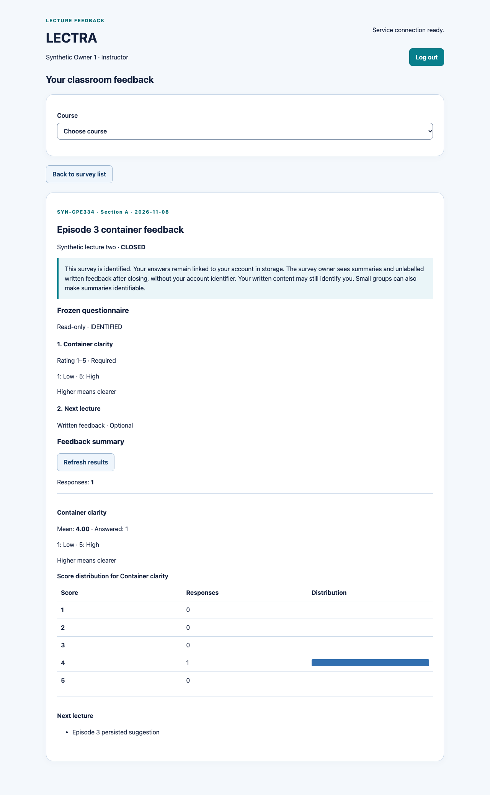
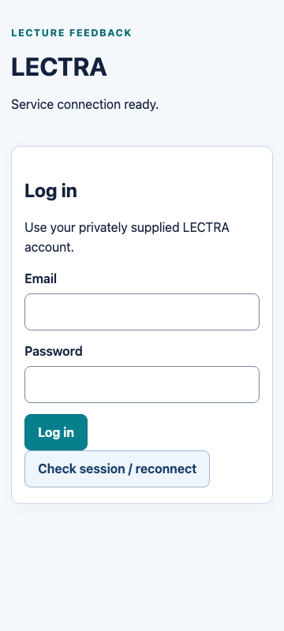

# Lab 5 Episode 3 — Docker packaging

Issue: [#53](https://github.com/Maibokdaimhai/LECTRA/issues/53). Branch: `build/53-docker`, created from accepted staging merge `566f9b09b100768c7c68a7add48600b4d4943d9e` (PR #52). PR target: staging; teammate review is required before merge.

## Instructor requirements versus adaptations

Student Guide V1.1 Episode 3 §§3.1–3.6 (PDF pp. 30–37) requires adapted Docker artifacts and an open PR. It recommends local build/start, login and record-persistence checks; these checks are performed here as well. The Lab 5 handout ultimately assesses reproducible container startup and persistent database data, so retaining real local execution evidence is useful. This episode creates no GCP resources and does not implement Episode 4 CI or Episode 5 deployment.

The starter kit uses `server/` and `client/`; LECTRA uses npm workspaces under `apps/api/` and `apps/web/`. These equivalent seven artifacts are committed:

| Starter example | LECTRA artifact | Responsibility |
| --- | --- | --- |
| Root `Dockerfile` | `Dockerfile` | Multi-stage unified API + SPA image for later CI/Cloud Run; no startup migration/seed |
| `.dockerignore` | `.dockerignore` | Excludes local dependencies/builds, generated Prisma client, private env files, .local, Git, docs and tests |
| `docker-compose.yml` | `docker-compose.yml` | Local PostgreSQL, forward-migration job, API and nginx web services |
| `server/Dockerfile` | `apps/api/Dockerfile` | API and explicit operator-job image, built from repository-root context |
| `server/docker-entrypoint.sh` | `apps/api/docker-entrypoint.sh` | `exec "$@"` hands signals to the selected command as PID 1 |
| `client/Dockerfile` | `apps/web/Dockerfile` | Build the Vite workspace and serve its output through non-root nginx |
| `client/nginx.conf` | `apps/web/nginx.conf` | Same-origin `/api` proxy, SPA route fallback, safe missing-asset behavior |

Additional implementation/test/helper/docs files are necessary adaptations, not a claim that the guide itself mandates their exact names or design. Express now serves the built SPA in the unified production image. Unknown API routes still produce JSON 404; missing assets/dotfiles/unsafe methods are not disguised as successful SPA pages. No npm dependency was added. Node 24.22.1, npm 10.9.2 and PostgreSQL 17 remain the accepted runtime versions. Debian bookworm-slim supports the API/Prisma/Argon2 toolchain; nginx 1.28-alpine serves Compose assets. Actual resolved image IDs/architecture are recorded in the Docker verification results; this run is arm64, not an amd64/Cloud Run execution claim.

Static exclusions use one safely decoded pathname, matching static-file handling: encoded dotfiles/extensions/assets cannot fall through to the SPA. Malformed URI encoding or a decoded null byte returns 400. Existing encoded assets and client routes still work; query-string encoding is not interpreted as part of the pathname.

`.gitattributes` keeps shell entrypoints at LF line endings across checkouts, including when a Windows Git client otherwise prefers CRLF. Dockerfiles set the entrypoint execute permission during image build.

## Service review and trust boundaries

| Service | Role | Startup dependency | Data/ports |
| --- | --- | --- | --- |
| `db` | PostgreSQL 17, UTC application pools | TCP health check must pass | Named `postgres_data` volume; no host database port is published |
| `migrate` | Explicit `prisma migrate deploy` via Episode 2's guarded production command, exits 0 | Healthy db | Same database; no reset or automatic demo seed |
| `server` | Real API/auth/domain logic, `node` user | Healthy db and successful migrate job | Internal 3001, loopback host API_PORT (default 3001) |
| `client` | Built SPA and `/api` proxy, `nginx` user | Healthy server | Internal 8080, loopback host WEB_PORT (default 5173) |

**Deliberate seed adaptation:** the example migrate service performs both migration and seed. LECTRA separates the seed into a named, explicit operator command after initial startup. Rerunning fixture verification after someone edits/publishes a seeded Draft would correctly refuse rather than overwrite it; making that seed automatic on every Compose up would unnecessarily block later restarts. The Docker verifier proves startup has zero users, runs the seed explicitly, and later down/up neither reseeds nor duplicates the seven accounts. The instructor's persistence requirement is preserved; the exact startup/seed arrangement is the team's adaptation.

Local Compose uses `NODE_ENV=development`, HTTP `APP_ORIGIN` and `TRUST_PROXY=none` because it is a loopback HTTP demo. Actual login, CSRF, ownership and PostgreSQL sessions remain mandatory. It is not a production deployment configuration. The root image defaults to `NODE_ENV=production`; real deployment needs HTTPS APP_ORIGIN, stable secret injection and reviewed proxy topology as documented in Episode 2. The unified-image local verification simulates TLS termination using one forwarded HTTPS hop; it does not claim real HTTPS/Cloud Run verification.

Both Node images contain compiled API, generated Prisma client, migrations/schema, fixture definitions and the explicit production operator scripts. The root image also contains built SPA assets. Installed CLI/tsx packages are intentionally retained so a separate migration job can use the same image; this is not a claim of a minimal production-only dependency tree. There is no application response/file storage on the container disk. The only persistent application store is PostgreSQL and its named volume.

## Run from a checkout

Prerequisites: Git, pinned Node/npm on PATH, Docker engine using Linux containers and Compose v2+ (actual verification used Compose 5.5.0). Manual Compose commands can be used on Docker-supported desktops; the automated Python/browser verification below supports macOS/Linux/WSL 2, not native Windows Python. See [WSL preparation](deployment.md#exact-wsl-2--ubuntu-reproduction-steps) for Linux tooling and Docker integration. Do not reuse Windows node_modules in WSL.

Use an unused clone directory. While this PR is open:

```sh
git clone --branch build/53-docker https://github.com/Maibokdaimhai/LECTRA.git
cd LECTRA
git rev-parse HEAD
node --version
npm --version
docker version
docker compose version
npm run setup:docker
docker compose --env-file .local/docker.env -p lectra-local up --build -d
docker compose --env-file .local/docker.env -p lectra-local ps -a
```

After merge, use the actual reviewed staging revision rather than assuming the feature branch remains. `setup:docker` uses only Node built-ins, so `npm ci` on the host is **not required for manual Compose startup**; npm ci/build run inside the Dockerfiles. The helper creates an ignored `.local/docker.env` with mode 0600 and distinct random URL-safe database/session/role credentials. It prints no secret and refuses to overwrite the file. Do not commit it or regenerate credentials against an existing volume. Keep the project name `lectra-local` stable to resume that project/volume; use a different explicit project name/config for an isolated experiment.

Wait until db/server/client are running (server healthy) and migrate has exited 0. Then explicitly bootstrap the empty demo database once:

```sh
docker compose --env-file .local/docker.env -p lectra-local run --rm migrate npm run db:seed:production
curl --fail http://127.0.0.1:3001/api/health
curl --fail http://127.0.0.1:3001/api/ready
curl --fail http://127.0.0.1:5173/api/ready
```

In Windows PowerShell use `curl.exe` for the three HTTP commands. Open **http://127.0.0.1:5173**, keeping the exact origin (do not substitute localhost). Read the two seed passwords locally from the ignored env file and use `owner.1@example.test` / `respondent.11@example.test`. Never paste passwords into GitHub, screenshots or the report. The login page displays no default password. If ports conflict, edit WEB_PORT/API_PORT and the matching APP_ORIGIN in the private file before startup. Generated database passwords are URL-safe; arbitrary punctuation in a hand-edited database password would need correct URI encoding.

Use synthetic Lecture 2 for the feedback journey: owner creates and publishes a questionnaire, eligible student submits, owner closes and reads results. The seed's Lecture 1 Draft may also be used, but once changed its seed rerun will intentionally refuse. No seed is needed for ordinary restarts.

```sh
docker compose --env-file .local/docker.env -p lectra-local down
docker compose --env-file .local/docker.env -p lectra-local up -d
docker compose --env-file .local/docker.env -p lectra-local ps -a
```

Reopen the same origin and verify the same feedback record. Do **not** add `-v`: it deletes the named database volume. `stop` stops containers without removing them; `down` removes containers/network and preserves the volume unless explicitly told otherwise. Do not reset or remove an existing volume just to make seed/password checks pass.

## Environment and commands

All real values are injected at runtime. No Dockerfile build ARG/ENV contains credentials; only non-secret mode/port defaults are baked in. Root `.env.example` lists the Compose and verifier settings as comments; actual generated credentials live only in .local.

| Setting | Purpose / reader |
| --- | --- |
| `POSTGRES_PASSWORD` | Private URL-safe database credential, supplied to db/migrate/server through Compose |
| `SESSION_SECRET` | Private stable session-signing secret, supplied to server; retain across restarts |
| `SEED_OWNER_PASSWORD`, `SEED_RESPONDENT_PASSWORD` | Distinct private synthetic demo passwords, passed only to explicit setup job |
| `APP_ORIGIN` | Exact HTTP web origin for local Compose; production image needs separately configured HTTPS origin |
| `WEB_PORT`, `API_PORT` | Loopback host mappings; defaults 5173/3001 |
| `API_IMAGE`, `WEB_IMAGE` | Optional local image tags; verifier uses task-unique tags |
| `DATABASE_URL`, `ALLOW_PRODUCTION_DATABASE`, `SEED_PRODUCTION_DEMO`, `NODE_ENV`, `PORT`, `TRUST_PROXY` | Supplied within Compose using the Episode 2 contracts; no host database migration is invoked |
| `EP3_BASE_URL`, `EP3_EVIDENCE_DIR`, `EP3_BROWSER_STATE_FILE`, `EP3_BROWSER_PHASE` | Verifier-only browser inputs; never deployed. Cookie storage stays in an ignored private directory. |

Build the unified image independently from the repository root:

```sh
docker build -t lectra-unified:episode3 .
```

This build does not need DATABASE_URL or a running DB. Runtime invocation still needs private environment configuration and a reachable database; the automated verifier below demonstrates the actual root-image run against its isolated Compose network. The image's command is `node apps/api/dist/server.js`, with exec entrypoint, `USER node`, production mode and default PORT 3001; supply another PORT through environment for Cloud Run later. Explicit migration/seed jobs can override CMD with the Episode 2 npm commands. Do not automatically migrate/seed on web process startup.

## Reproduce automated verification

On supported macOS/Linux/WSL 2, from the repository root:

```sh
npm ci
# macOS:
npm run browsers:install
# Ubuntu/WSL instead: node scripts/playwright.mjs install --with-deps chromium
python3 scripts/verify-lab5-episode3.py --create-local-containers
```

Python 3.10+, pinned Node/npm, Docker and installed Chromium are required. The verifier creates task-specific credentials, image tags, Compose project, host ports and volume; performs real API/Chromium checks; down/up retains the volume; the temporary unified container is stopped and removed after its checks; finally the verifier stops only its own Compose containers. It never deletes the data volume or changes GCP/IAM/billing. Private env/browser-cookie files are retained in an ignored mode-0700 directory for inspection. Output defaults there too; use `--evidence-dir <new-directory>` for an intentional evidence record. An existing results.json is not overwritten.

The verifier removes every key it generates for the Compose env file from the inherited subprocess environment, including WEB_PORT, API_PORT and POSTGRES_PASSWORD. This prevents shell precedence from overriding the isolated configuration; Docker access/tool-path settings remain available. The managed-key list is derived from the generated values, not maintained as a separate hardcoded list. Its Python regressions run with `python3 -m unittest discover -s tests/tooling -p 'test_*.py' -v`.

Checks include all service states, explicit seed/no automatic reseed, built HTML/asset loading, real login, author/publish/respond/close/results, required-answer and duplicate rejection, actual browser login/results, unified production PORT/secure-cookie/API checks, SIGTERM exit 0, database snapshot equality, owner/student readback and absolute session expiry after down/up, resumed browser session and successful logout. These are executable checks; the images are rendered from the actual packaged UI with synthetic data.

The existing regression matrix can be reproduced separately using `python3 scripts/verify-lab5-episode2.py --create-local-test-databases`. The review-corrected candidate has 249 selected Vitest/Playwright tests, plus four separate Python environment tests. Episode 3's original 241, Episode 2's historical 239 and Sprint 1's historical 219 remain unchanged historical records. See [Episode 3 evidence](evidence/episode-3/README.md) for actual outcomes, limitations and retained failed attempts.

## Evidence illustrations


Before down/up: the instructor is logged in through nginx and sees the closed questionnaire, score distribution and persisted synthetic suggestion.



After down/up with the same database volume: the saved browser session resumes and the same stored feedback is visible.



After restart verification, logout returns to the login page with private results hidden. No credential field or session token is included in these screenshots.

## Primary technical references

- [Docker multi-stage builds](https://docs.docker.com/build/building/multi-stage/) explains separating build and runtime stages.
- [Compose startup dependencies](https://docs.docker.com/compose/how-tos/startup-order/) explains healthy-database and completed-migration gates.
- [Express static files](https://expressjs.com/en/starter/static-files/) documents serving built assets from an absolute root. LECTRA's API-first routing and constrained SPA fallback are application choices.
