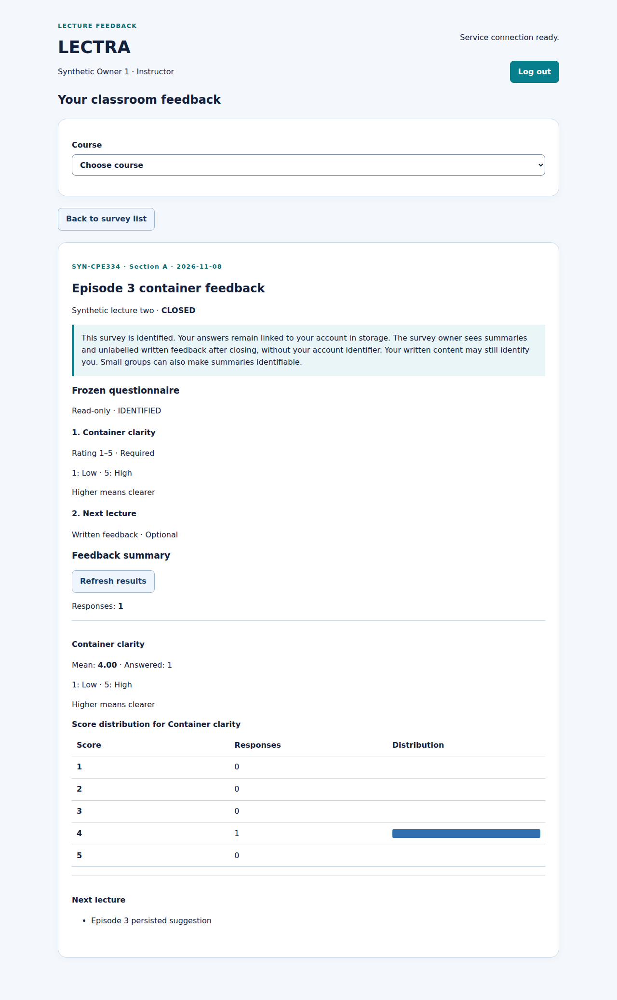
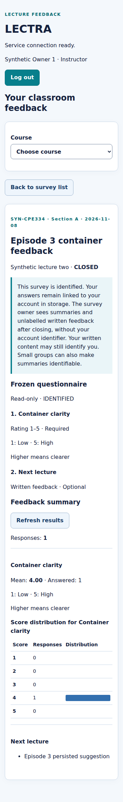
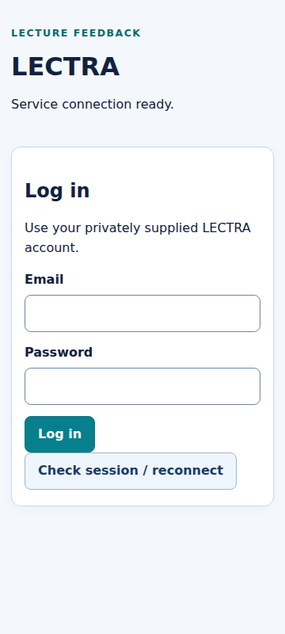

# Actual GitHub Actions evidence — run 43580925042

[Run and all step logs](https://github.com/Maibokdaimhai/LECTRA/actions/runs/43580925042) · [Original artifact](https://github.com/Maibokdaimhai/LECTRA/actions/runs/43580925042/artifacts/14108183222)

Executed automatically for implementation PR #56 targeting staging, on 14 November 2026, 09:31–09:36 UTC. Job `test-and-docker` and all validation/upload steps **succeeded**. This is author-executed automated evidence, not teammate approval.

- PR head: `bec735bdceaec6cd6de26229826dd463c8d6ed86`.
- PR base: `e4eeec9e29f1eab7c12fbce03657c3480e7c0e80`.
- Actual tested synthetic merge checkout: `d6ca26bb30d490bbb3361a26f092a51a8604b6f9` (`refs/pull/56/merge`).
- Actual host: Ubuntu runner / Linux x86_64, Node 24.22.1, npm 10.9.2, Python 3.14.10, Docker 28.0.4, Compose 2.38.2. PostgreSQL 17 service.

## Results and provenance

| Evidence | Actual outcome |
| --- | --- |
| `artifact/ci-evidence/regression/results.json` and 17 command logs | All 17 commands exit 0; 249 selected application tests pass; typecheck, build, ORM and process restart succeed |
| `artifact/ci-evidence/offline-tests.txt` | Six deploy and five release stub scenarios, plus ten Python guard/smoke tests pass |
| `artifact/ci-evidence/tooling-tests.txt` | Four Python verifier-environment tests pass |
| `artifact/ci-docker/results.json` and 18 command logs | All 18 commands exit 0; all 30 Docker checks pass |
| Docker image metadata in that results file | API, nginx web and unified images actually built as amd64 and use non-root runtime users |
| `run.json`, `jobs.json`, `artifacts.json` | Public run identity, real step conclusions, original artifact metadata/digest |

The application count is 137 Vitest cases plus 112 selected Playwright cases = 249. Shell/Python/Docker checks are reported separately, not added to historical Sprint 1 results. At collection, all 104 regression source hashes and all 80 Docker source hashes matched the checked-out PR files. Results and command logs under `artifact/` are the extracted, unmodified uploaded artifact; no private environment or cookie files were present. The subsequent evidence-only commit preserves these assessed source files. Its own latest check is recorded on the PR separately to avoid claiming this earlier run tested a later commit.

## Actual Chromium screenshots

The verifier reuses the Episode 3 container fixture; its survey and feedback names therefore say Episode 3. These images were generated afresh during this Episode 4 CI run with synthetic accounts/data.

Before container down/up: closed survey results, one response and mean 4.00, desktop viewport.

Before container down/up: same stored results at the narrow viewport.

After down/up using the retained database volume: authenticated owner returns to the same results and written feedback.

After down/up: same persisted results at the narrow viewport.

After logout: browser returns to the login screen. Corresponding browser/API assertions are in `browser-after.txt` and `results.json`.

## Gates still requiring human integration

This run proves the staging-target implementation check. It does not prove review/approval, a staging merge, the main-target release check, a main merge, branch-protection enforcement or deployment to GCP. Draft release PR #57 must wait for #56 to merge and then pass its own check. Close issue #55 only after the guide's reviewed main integration gate is verified.
