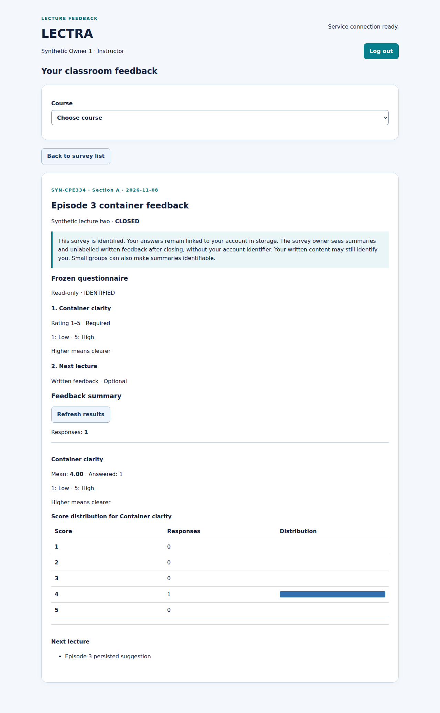
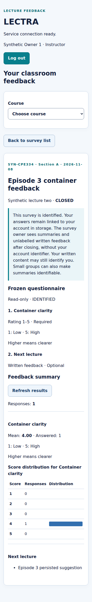
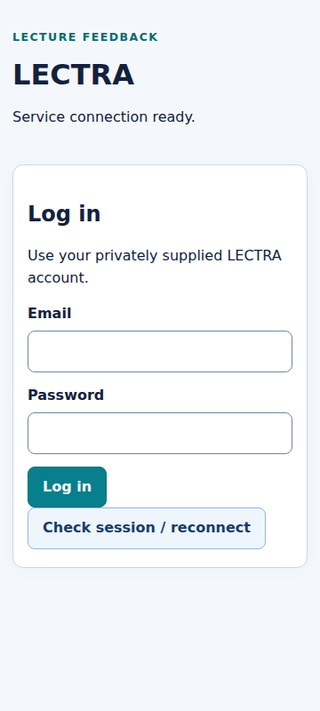

# Actual main-target release check — run 43584455186

[Successful run and all step logs](https://github.com/Maibokdaimhai/LECTRA/actions/runs/43584455186) · [Original artifact](https://github.com/Maibokdaimhai/LECTRA/actions/runs/43584455186/artifacts/14110385092)

Automatically executed for **PR #57, staging → main**, after R1NNE0 approved implementation head `bec735b` and PR #56 merged as `b5019400339b21c4d113f08b41ba2b9ff0bfa40d`. The release remains a draft awaiting final evidence integration and teammate review; this check does not imply approval or a main merge.

- Release head: `b5019400339b21c4d113f08b41ba2b9ff0bfa40d`.
- Actual tested synthetic merge checkout: `ea0611743845307a7b12c407f69fd7fd69df58cb`.
- Actual PR head/base/event metadata: `artifact/ci-evidence/regression/results.json`.
- Same stable job `test-and-docker`: success on Linux x86_64.
- All 17 matrix commands and **249 selected application tests passed**; typecheck/build/ORM/restart successful.
- All 18 Docker commands and **30 checks passed**, including fresh amd64 API/web/unified builds and actual browser/persistence checks.
- Separately: ten Python guard/smoke tests, four Python tooling tests and eleven shell stub scenarios pass.
- All 104 regression and 80 Docker source hashes match the files in this evidence branch at collection. No application/workflow/deploy changes are introduced by this evidence branch.

The extracted artifact is retained unmodified under `artifact/`; metadata under `run.json`, `jobs.json`, `artifacts.json` records provenance. Five actual Chromium screenshots use the same synthetic container fixture as the implementation run:

Before down/up, desktop results: one stored response, mean 4.00.

Before down/up, narrow results.

After down/up, persisted session and results, desktop.

After down/up, same results at narrow viewport.

Logout returns to login; assertions/logs accompany the image.

Any later staging update triggers another release check. The then-current PR head must pass and receive teammate approval before merge; do not reuse this earlier success as evidence for changed source. Confirm workflow/deploy files on main before issue #55 is Done.
