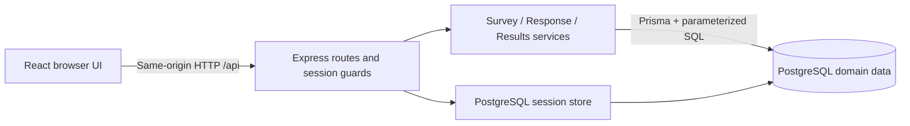
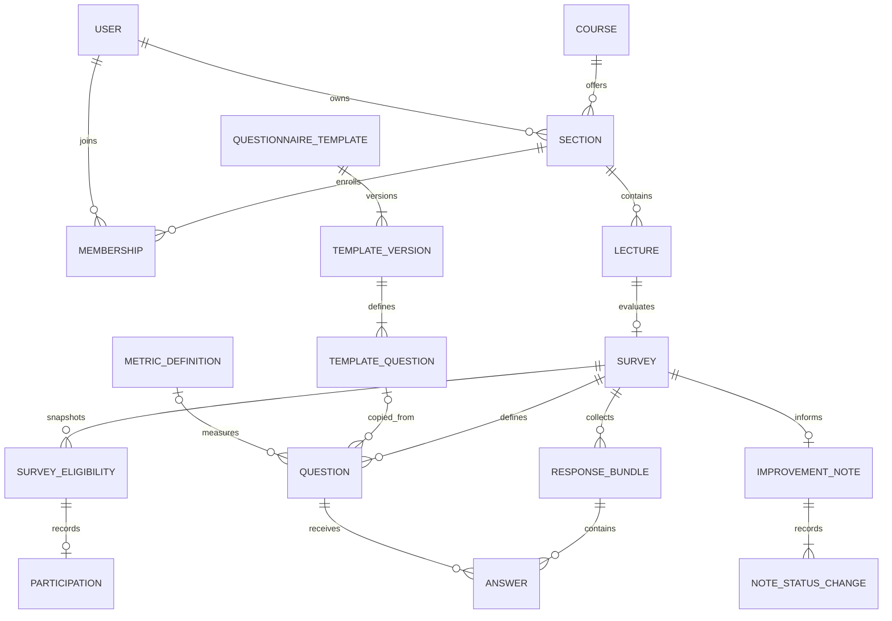

# LECTRA — System-Level Software Design Specification

Version: 0.4 (2026-11-06). Status: revised planning draft, not implemented or teammate-approved. Retains the cool-color theme from revisions 0.2–0.3. Revision 0.4 adds explicit Course/Section context, versioned starter copies, comparison semantics, private improvement notes and engineering details from the product-direction review. These are documented future features, not completed implementation.
Related issue: [#3](https://github.com/Maibokdaimhai/LECTRA/issues/3).
Baseline: [SRS](srs.md), [decisions](decisions.md), [features](features.md).

## 1. Stack and components

| Layer | Selected tools | Responsibility |
| --- | --- | --- |
| Browser | React, Vite, TypeScript; ordinary CSS | Role-specific screens, accessible inputs, client feedback and API calls. No authoritative permission decisions. |
| API/application | Node.js, Express, TypeScript, Zod | Session-derived identity, validation, authorization, survey transitions, response transactions and results. |
| Authentication | express-session, connect-pg-simple, Argon2id | Opaque cookie session with PostgreSQL storage; password hashing and revocable logout. |
| Domain persistence | PostgreSQL, Prisma ORM | Domain queries, migrations, constraints and atomic transactions. Reviewed parameterized SQL is allowed for row locks/constraints where needed. |
| Tests | Vitest, Supertest, Playwright | Unit logic, HTTP API with real PostgreSQL integration, selected browser journeys. |
| Delivery plan | Docker, GitHub Actions, GCP Cloud Run and Cloud SQL for PostgreSQL | Proposed Lab 5 packaging, quality gates, application runtime and durable database. No infrastructure has been created. |

The frontend/test/database choices come from the project owner. The API/session/hash/validation/API-test additions fill missing responsibilities under explicit permission to choose additions. Compatible versions and type definitions must be pinned during authorized setup, before API-specific implementation contracts are finalized. No package is installed by this document.

The monolith has three logical layers, not three mandatory servers. In development, Vite proxies `/api` to Express. In release, Express serves the built frontend and `/api` on one origin. PostgreSQL is external to the application process/container. Business rules reside in application services plus database constraints, never only in React.

Proposed repository layout after setup: `apps/web`, `apps/api`, `prisma`, `tests/e2e`, and `docs`. This is a plan; those application directories do not exist yet. Use npm workspaces and one lockfile unless a recorded compatibility issue requires a different package-manager decision.

## 2. Major data model

| Entity | Important fields | Relationships / constraints |
| --- | --- | --- |
| User | id, email, passwordHash, role, displayName | Unique normalized email; role OWNER or RESPONDENT. |
| Course | id, code, title | Unique course code; academic context only, not an ownership boundary. Seeded read-only context. |
| Section | id, courseId, term, sectionCode, ownerId | FK to Course and instructor; unique `(courseId, term, sectionCode)`; each owner accesses only their Sections, including when another owner teaches the same Course. |
| Membership | sectionId, studentId | Unique pair; student role validated on seed/use. No attendance/grade data. |
| Lecture | id, sectionId, title, lectureDate, sequence | Belongs to one Section; local calendar date plus ordering sequence. Unique `(sectionId, sequence)`; dates need not be unique. |
| Survey | id, lectureId, ownerId, title, status, mode, publishedAt, closedAt, sourceTemplateVersionId nullable | Unique lectureId; owner must match Section owner; transitions governed by service transaction. Provenance does not grant source access or trigger live updates. |
| Question | id, surveyId, position, prompt, type, required, category nullable, ratingMinLabel/ratingMaxLabel, sourceTemplateQuestionId nullable, metricDefinitionId nullable | Unique survey/position; type RATING/TEXT in S1, SINGLE_CHOICE in S2. Prompt/anchors/options are stored snapshots. Provenance and metric metadata are S2 additions. |
| ChoiceOption (S2) | id, questionId, position, label | Unique question/position; selected answer must belong to its question. |
| SurveyEligibility | surveyId, studentId | Unique pair; publication snapshot, immutable after publish. |
| Participation | surveyId, studentId | Unique pair and FK to eligibility. The participation row is the submission-status source and carries no anonymous answer ID or per-submission timestamp. |
| ResponseBundle | id, surveyId, identifiedStudentId nullable | S1 identifiedStudentId is required by mode-aware service validation and references eligibility. In anonymous mode it must be null. No precise per-bundle submission timestamp. |
| Answer | bundleId, surveyId, questionId, ratingValue/textValue/optionId | Unique bundle/question; composite foreign keys keep bundle and question in the same survey; one type-specific value only; rating range CHECK 1–5. |
| Session store | sid, session payload, expiry | Managed by connect-pg-simple in a separately named table, schema created with versioned SQL migration rather than implicit production auto-create. |
| QuestionnaireTemplate (S2) | id, key, name | Unique stable key, e.g. `lecture-feedback`; seeded catalog, no public authoring API. |
| TemplateVersion (S2) | id, templateId, version, state | Unique template/version; published versions are immutable; retiring a version prevents new selection but preserves old provenance. |
| TemplateQuestion / TemplateOption (S2) | id, templateVersionId/questionId, position, category, prompt, type, required, anchors/options, metricDefinitionId nullable | Immutable definitions scoped to the template version; copying creates independent survey rows with new IDs. |
| MetricDefinition (S2) | id, key, version, canonicalPrompt, type, min/max, anchor labels, interpretation, category | Immutable measurement identity. Source-version lineage alone is not comparability. Non-rating definitions have no numeric trend in the initial baseline. |
| ImprovementNote (S3) | id, surveyId, ownerId, issueSummary, plannedAction, outcomeReflection nullable, status, revision, createdAt, updatedAt, appliedAt nullable | Unique surveyId; owner matches survey owner; default Planned, revision starts at 1; owner-private only. |
| NoteStatusChange (S3) | id, noteId, actorId, fromStatus nullable, toStatus, reason nullable, changedAt | Append-only creation/status history in the same transaction as the note update. Does not store raw response excerpts or full previous note bodies. |

Database CHECKs/foreign keys/unique constraints cover what can be expressed locally. Cross-table rules (e.g. owner/Section consistency, answer type, response mode, required-question completeness) are checked by the authoritative service inside the transaction. Composite keys and relevant FK targets are specified fully in feature contracts and migrations before implementation. A unique index on `(surveyId, identifiedStudentId)` is additional protection for identified bundles; anonymous duplicate prevention uses Participation uniqueness.

`Classroom` in previous drafts is replaced by `Section`, not retained as a second overlapping entity. The repository has no implemented schema or migration yet; this is a planning correction, not a claim that a production migration ran. Resolve access through `Survey → Lecture → Section → owner` and validate redundant `Survey.ownerId`/`ImprovementNote.ownerId` consistently; never trust the supplied Course, Section or owner ID. Course-level aggregation always starts from owned Sections.

The diagram intentionally has no Participation → anonymous ResponseBundle association. Identified bundles have a student FK as stated in the table; the absence of a drawn link is not a claim of anonymous Sprint 1 storage. A template/question provenance link points to an immutable source definition, never to live display text.

Published questions/eligibility are immutable and cannot be removed through application routes. Draft deletion cascades Draft questions only after owner/state checks. Published records have no hard-delete application operation. Schema migration and deletion behavior must preserve submitted associations.

## 3. Transactions and concurrency

1. Every Draft mutation, deletion and publication locks the same Survey row before checking state. Publish validates questions, owned Course/Section/Lecture and candidate membership, creates the eligibility snapshot, then commits Published state atomically. This prevents an edit racing publication from changing a published question after a stale Draft check.
2. Submit locks the Survey row before reading its authoritative state, verifies the session student is eligible, checks typed answers, inserts unique Participation, bundle and all answers, and commits together.
3. Close takes the same row lock and changes Published to Closed. The lock/commit order defines BR-11, not arrival order at the browser or a client timestamp.
4. Concurrent duplicates are rejected by the database unique constraint even if both requests passed an earlier check. Map the constraint to a safe domain error; no partial answers remain.
5. New survey creation, starter application and duplicate-to-Draft check the owned target lecture and rely on unique `Survey.lectureId` under concurrency. Copy all definitions or none; no partly populated Draft is returned as successful.
6. Note creation locks/checks the survey's Closed/result-visible state and uses unique surveyId. Note edits check owner and expected revision, update with a revision increment, and append any status transition atomically. A stale edit returns 409 with no lost update or partial history row.

Serialize per-survey submissions initially to keep correctness simple for a small classroom. Keep lock duration short; do not hash passwords, call external services or render results while holding it. Retry recognized deadlock/serialization failures only with a bounded policy defined in the contract. A lost confirmation never permits a second write; the student checks their persisted submission status.

Prisma transaction APIs depend on the pinned ORM version. This SDS specifies behavior and locking without assuming a particular version's client syntax.

## 4. Authentication and session lifecycle

- Login accepts email/password, compares an Argon2id password hash, returns a generic invalid-credentials message and never logs credentials. Seeded accounts are sufficient; no signup/recovery endpoints.
- Regenerate the session ID after successful authentication. Store only the minimum server-side identity data; re-resolve user role/permissions from trusted storage on protected requests.
- Use PostgreSQL session storage, not process-local MemoryStore. Set `resave: false` and `saveUninitialized: false`; pin and verify compatible middleware/store versions.
- Cookie: `HttpOnly`, `SameSite=Lax`, `Path=/`, fixed eight-hour expiry without rolling renewal; `Secure` in HTTPS deployment. Local HTTP development may disable Secure explicitly. Store authentication time and enforce the absolute eight-hour age server-side as well; cookie/store refresh behavior must not silently extend the authenticated lifetime.
- `GET /api/auth/me` returns the current safe user identity or 401. Expired or missing sessions cannot access protected routes.
- `POST /api/auth/logout` destroys the server session and clears the cookie; subsequent replay of that cookie is unauthorized. Logout is idempotent.
- State-changing browser requests require a synchronizer CSRF token in `X-CSRF-Token`, including login/logout, plus Origin checking against the configured application origin. A session endpoint bootstraps the token. Do not treat SameSite alone as the complete CSRF control.
- Configure trusted proxy handling for the actual Cloud Run path; do not trust arbitrary forwarded headers. Add bounded login throttling before public deployment, with limits and tests specified in the authentication contract.

## 5. Role and record access matrix

All entries are backend rules. Inaccessible record identifiers return 404 to avoid confirming existence; an authenticated wrong role for a role-only operation returns 403; unauthenticated access returns 401. No private data accompanies rejection.

| Operation | Respondent | Owner |
| --- | --- | --- |
| Login/logout/me | Own session | Own session |
| List contexts | Eligible Published/Closed surveys only | Course context through owned Sections, owned lectures/surveys only |
| Read Draft / create/edit/delete Draft | Denied | Own only |
| Publish/close | Denied | Own only |
| Read survey for answering | Eligible Published/Closed; submitting requires Published | Own preview; cannot submit as student |
| Submit response | Eligible, Published, not already submitted | Denied |
| Read submission status | Own only | No per-student participation endpoint |
| Read identified answers | Own only | No respondent-linked answer endpoint |
| Read anonymous answers by identity | No such operation | No such operation |
| Read results/text | Denied | Own; count while Published, results after Closed under threshold policy |
| Export aggregates (S2) | Denied | Same constraints as results |
| Preview starter catalog/version (S2) | Denied | Read published selectable seeded versions; no template-edit API |
| Apply starter / duplicate survey (S2) | Denied | Own target lecture; source survey must also be owned; create Draft only |
| Read history/trends (S3) | Denied | Owned Sections only; comparison/suppression rules still apply |
| Create/read/edit improvement note (S3) | Denied, including eligible respondents | Own Closed survey with visible results; note private; revision checks on writes |
| Share improvement note | No baseline operation | No baseline operation |

## 6. UI and API conventions

Main screens: login; student eligible-survey list, answering form and confirmation/own-status view; instructor survey list, Draft editor, survey detail/publication/closing controls, and results. Course/Section/Lecture context is visible in creation and answering flows. Later additions: mode selection, starter preview/apply, single-choice/subset controls, CSV action, history filters/trends and owner-private improvement note panel.

Every screen defines loading, empty, validation, unauthorized/expired-session and safe unexpected-error states. Disable repeated UI submission for feedback, but rely on backend/DB protection. Clear private cached UI state on logout. Result views never receive hidden identity fields. Do not display blank required text as valid or a null mean as zero.

### 6.1 Visual theme: cool blue and teal

The project owner requested a cool-color theme. LECTRA uses a calm, readable light interface with blue primary actions, teal secondary emphasis, pale slate backgrounds and dark slate text. This palette is a project design decision, not an instructor requirement. Apply it consistently to both instructor and student screens; roles differ through navigation and permissions, not separate branding.

#### 6.1.1 Theme intent and implementation boundary

The visual priority is a readable lecture-feedback form and an understandable results view. Use blue to identify the next action, teal for supporting emphasis and slate for structure. Do not make every card, heading or statistic compete with the primary action. Each action group has at most one primary button; navigation and result panels are quieter than the task content.

All measurements and component choices below are LECTRA design specifications. They do not add an instructor-imposed screen quota, require a UI framework or imply an implemented design system. CSS custom properties and small shared React components are sufficient. Sprint 1 uses the same theme for both roles and supports the existing feature scope only.

#### 6.1.2 Foundations and color tokens

Use semantic CSS custom properties so components share tokens rather than repeating arbitrary hex values. The table specifies the planned values; it is not an implemented stylesheet.

| Token | Value | Use |
| --- | --- | --- |
| `--color-bg` | `#F8FAFC` | Page background. |
| `--color-surface` | `#FFFFFF` | Cards, forms, dialogs and tables. |
| `--color-surface-muted` | `#F1F5F9` | Table headers, secondary panels and subtle grouping. |
| `--color-border-subtle` | `#CBD5E1` | Decorative separators; not the sole boundary of an interactive control. |
| `--color-border-control` | `#64748B` | Input and unselected rating-control boundaries on light surfaces. |
| `--color-text` | `#0F172A` | Headings, body text and labels. |
| `--color-text-muted` | `#475569` | Supporting text, descriptions and readable placeholders. |
| `--color-primary` | `#1D4ED8` | Primary actions, links, active navigation and selected rating controls. |
| `--color-primary-hover` | `#1E40AF` | Primary action hover/pressed emphasis. |
| `--color-on-primary` | `#FFFFFF` | Text/icons on solid primary buttons and selected rating controls. |
| `--color-primary-soft` | `#DBEAFE` | Selected navigation backgrounds; pair with primary-colored text. |
| `--color-secondary` | `#0F766E` | Teal secondary emphasis and Published badges. |
| `--color-secondary-soft` | `#CCFBF1` | Teal information surfaces; pair with secondary-colored text. |
| `--color-focus` | `#2563EB` | Keyboard focus outline with separation from the control. |
| `--color-primary-active` | `#1E3A8A` | Pressed primary controls; keep white text. |
| `--color-secondary-hover` | `#115E59` | Hover on a solid teal control, if used; keep white text. |
| `--color-disabled-bg` | `#E2E8F0` | Inactive controls with explicit disabled semantics. |
| `--color-disabled-text` | `#475569` | Readable inactive labels; never use opacity on the whole control as the only disabled treatment. |
| `--color-backdrop` | `rgb(15 23 42 / 40%)` | Overlay behind a modal dialog; never behind ordinary page text. |

Neutral reference scale: slate 50 `#F8FAFC`, 100 `#F1F5F9`, 200 `#E2E8F0`, 300 `#CBD5E1`, 400 `#94A3B8`, 500 `#64748B`, 600 `#475569`, 700 `#334155`, 800 `#1E293B`, 900 `#0F172A`. Lighter steps are surfaces/decorative colors, not substitutes for readable body text.

Semantic feedback may use green, amber and red even though the overall theme is cool. Preserve recognizable meaning rather than forcing every error or warning into blue.

#### 6.1.3 Semantic states

| Meaning | Foreground | Background | Required accompanying content |
| --- | --- | --- | --- |
| Success / submission confirmed | `#166534` | `#F0FDF4` | Check icon and explicit confirmation text. |
| Warning / irreversible closing | `#92400E` | `#FFFBEB` | Warning icon and consequence text. |
| Error / invalid answer / denied action | `#B91C1C` | `#FEF2F2` | Error text, field association where relevant, and recovery guidance. |
| Draft or Closed | `#475569` | `#F1F5F9` | Explicit Draft/Closed label; Closed is not inherently an error. |
| Published | `#0F766E` | `#CCFBF1` | Explicit Published label; do not imply an ineligible student may answer. |

The semantic foreground/background pairs also define reusable `success`, `warning`, `error`, `neutral` and `published` tokens. Apply them to badges and inline messages consistently rather than inventing screen-specific colors. Icons supplement the literal state label; they do not replace it. Identified/Anonymous privacy labels use neutral or information styling and explicit disclosure, not a green shield implying a security guarantee.

Component and chart application principles:

- Primary buttons use white text on blue; secondary buttons use a white surface, blue text and a visible control border. Destructive actions use the error color and explicit wording rather than a blue primary treatment.
- Form controls use white surfaces, dark text and control borders. Focus uses a visible 2px blue outline with a 2px surface-colored offset. Selected ratings include a checked/selected indicator and accessible state, not color alone. Disabled controls remain identifiable and expose their disabled state programmatically.
- Survey-state badges, validation and loading/submission feedback always include text or an icon with an accessible name. Color never encodes permission, privacy mode or completion by itself.
- Rating distributions use blue bars (`--color-primary`) on a light surface with visible score labels 1–5 and numeric counts. A single ordered series does not need five different colors. Compare compatible series with blue/teal plus distinct labels or patterns and an accompanying data table. Do not assume a higher pacing score is necessarily better or invent an overall quality score from unrelated questions.
- Reserve saturated colors for actions, selection and essential information. Keep reading and answering surfaces predominantly white/pale slate without decorative gradients behind text.

#### 6.1.4 Typography, spacing and surfaces

Use a local system sans-serif stack (`system-ui`, `-apple-system`, `"Segoe UI"`, `Tahoma`, `sans-serif`) with Thai-capable platform fallbacks; no external font service is required. Use relative CSS font units with the pixel equivalents below at the default 16px root. Do not shrink the root to defeat browser text-size preferences. Verify actual Thai/English fallback rendering on the target browser; avoid forced uppercase and decorative letter spacing in Thai text.

| Text role | Size | Weight | Line height | Use |
| --- | --- | --- | --- | --- |
| Page title | 32px / 2rem desktop; 24px / 1.5rem narrow | 700 | 1.35 | One page-level heading. |
| Section heading | 24px / 1.5rem | 600 | 1.4 | Major editor/results sections. |
| Card or question heading | 20px / 1.25rem | 600 | 1.5 | Survey card title or question group. |
| Body and entered values | 16px / 1rem | 400 | 1.6 | Form content, instructions, text feedback. |
| Field label and button | 16px / 1rem | 500–600 | 1.5 | Persistent labels and action names. |
| Supporting text and badge | 14px / 0.875rem | 400–500 | 1.5 | Help, metadata and status. Never the only presentation of a critical instruction. |
| Result number | 32px / 2rem | 700 | 1.25 | Count or mean, with a visible label and denominator where relevant. |

Keep long reading blocks near 65 characters per line where practical; allow Thai line wrapping rather than forcing a character count. Feedback uses preserved line breaks with wrapping and is rendered as plain text, never interpreted HTML. Do not truncate a student's submitted answer in the answer-reading view.

| Foundation token | Value / rule |
| --- | --- |
| Spacing scale | `4, 8, 12, 16, 24, 32, 48, 64px`; use named tokens in multiples of the 4px base. |
| Field label → control | 8px. |
| Control → helper/error | 8px; keep field explanation directly attached to its control. |
| Fields / question blocks | 24px between fields, 32px between question groups. |
| Card padding | 24px normally, 16px below 640px. |
| Radius | 8px controls; 12px cards/dialogs; full radius only for compact badges, not all buttons. |
| Border | 1px; subtle for decorative card/table separation, control border for active input identification. |
| Card elevation | None by default; optional `0 1px 2px rgb(15 23 42 / 6%)` for a raised card. |
| Dialog elevation | `0 16px 40px rgb(15 23 42 / 16%)` plus the modal backdrop. |
| Layer order | Base content 0, sticky navigation 10, floating menus 20, modal backdrop 30, modal dialog 40. Toast/status messages must not cover active dialog controls. |
| Control height | Minimum 44px; multiline text uses at least 4 visible lines and vertical resizing. |

Do not rely on shadows to identify inputs. On a white card, white inputs still have the control border. Do not hard-code component heights around text that may wrap or grow with browser zoom.

Contrast targets follow WCAG 2.2 AA: normal text at least 4.5:1, large text at least 3:1, and essential control/state indicators at least 3:1 against adjacent colors. Calculated reference pairs are white on primary blue 6.70:1, white on teal 5.47:1, dark text on page background 17.06:1, muted text on white 7.58:1, and control border on white 4.76:1. Semantic text/background pairs above exceed 4.5:1. These are palette calculations only, not proof that an unimplemented UI meets accessibility requirements. Recheck actual combinations, focus rings, hover states and chart indicators during implementation and selected UI/manual verification under NFR-07.

Sprint 1 implements the light theme only. A dark-mode toggle is outside the current baseline; any later dark theme requires its own surface/text/semantic tokens and contrast review rather than automatic color inversion.

#### 6.1.5 Interactive component specification

| Component | Default | Hover / pressed | Focus / selected | Disabled / busy / error |
| --- | --- | --- | --- | --- |
| Primary button | Blue surface, white label, 12px horizontal padding, 8px radius, ≥44px high. | Primary-hover / primary-active; no movement that changes layout. | Shared focus outline. | Slate disabled tokens plus disabled semantics. Busy retains action text with progress wording and blocks repeated activation. |
| Secondary button | White surface, primary text, control border; same sizing as primary. | Muted surface; primary text remains readable. | Shared outline; selection only for genuinely toggleable controls. | Same disabled treatment as primary. |
| Text action / link | Primary text; links within prose underlined. | Darker primary text, underline retained. | Shared outline and meaningful accessible name. | Render a disabled action as a button when appropriate; do not leave a fake clickable link. |
| Destructive button | Error foreground on white with error border for a secondary destructive choice; solid error color with white label only for the final destructive confirmation. | Darken within the error family; no blue hover override. | Shared visible focus treatment. | Preserve the reason the action is unavailable; never present destructive completion as success before server confirmation. |
| Text input / textarea | White surface, text token, control border, 12px internal padding. Persistent label above. | Border may use primary; no shadow required. | Primary border plus shared focus outline. | Validation adds error border, linked message and `aria-invalid`; errors remain visible until corrected/revalidated. |
| Rating group | Five equal-height labelled radio options, white surface and control borders. | Muted/blue-soft surface without implying committed selection. | Blue/white selected option plus checked indicator; native radio keyboard behavior. | Display group-level validation; never preselect a score. |
| Single-choice group (S2) | Labelled option radio list; each option wraps inside a ≥44px target. | Muted/blue-soft surface without selecting until activation. | Checked indicator and primary emphasis; native radio keyboard behavior. | Group-level errors; optional questions can remain unanswered. |
| Badge | Semantic foreground/background, 8px horizontal/4px vertical padding, text label. | No hover behavior unless it is actually a control. | Static badges are not tab stops. | State remains readable; use actual survey/participation state from the backend. |
| Survey card | White surface, subtle border, 12px radius, title and metadata, one clear action. | Only interactive parts receive control hover styling. | A named title link or explicit action, not multiple nested interactive card layers. | Closed/submitted status keeps a suitable view action; it does not look like a fresh submit action. |

Shared focus treatment is a 2px `--color-focus` outline with a 2px surface-colored gap. Check it on every actual surrounding surface; keep it outside clipping containers and visible beneath sticky headers. Use real `button`, `a`, `input`, `textarea` and radio controls before adding ARIA. Icon-only controls need an accessible name and a ≥44px hit area; decorative icons are hidden from assistive technology. No tooltip is required to understand a core action.

Question validation appears after an attempted submission or after the user leaves an edited field, rather than immediately marking an untouched empty form as wrong. On failed submission, show an error summary with links to invalid fields and move focus to it. Keep all entered answers available while validation or a recoverable request error is shown. A score is required only when the question's stored required flag says so. Optional rating/single-choice groups provide an explicit `Clear answer` control after selection; required groups do not silently default to a score. Clearing removes the value rather than sending null as an invented answer.

#### 6.1.6 Responsive application shell

The following breakpoints are layout choices, not new supported-device features. Build mobile-first and verify at 360px and 1280px as specified in NFR-07; also inspect 320px reflow and 200% browser zoom during final UI review.

| Width | Navigation and content | Form / results behavior |
| --- | --- | --- |
| Below 640px | Compact header; visible labelled navigation links wrap beneath it. No sidebar or new drawer interaction is required. Use 16px page gutters. | Single column; full-width primary action; rating options retain five equal columns at ≥44px each; question text wraps above them. Charts and feedback cards stack. |
| 640–1023px | Header navigation and 24px page gutters; optional two-column survey-card grid if content fits. | Answering form stays single column. Summary metrics may use two columns. |
| 1024px and above | Up to 240px instructor navigation column, with a content region capped at 1200px and 32px gutters. Student task navigation remains compact. | Survey lists and metrics may use grids. Answering form is capped at 760px; login card at 440px; an editor preview is optional, not Sprint 1 scope. |

Do not force an answering form into multiple question columns. Header actions wrap with labels intact. Tables may have their own labelled horizontal scroll container when a genuinely tabular view cannot reflow; the page itself and ordinary forms must not overflow horizontally. Place essential action buttons outside table-scroll regions. Long course codes, titles, errors and Thai text must wrap without covering adjacent controls.

Avoid a fixed mobile submit bar in Sprint 1; put the action at the end of the form so the on-screen keyboard does not hide a question or validation. On long forms, show the survey title/context and privacy disclosure before the first question; required-item count is allowed as a static hint, not a new progress-tracking feature.

#### 6.1.7 Screen-by-screen theme application

| Screen | Content hierarchy and theme | Primary action and state handling |
| --- | --- | --- |
| Login | Pale page background, white centred card, LECTRA name, brief purpose, labelled email/password fields. No decorative illustration is required. | `Log in`; generic credential error in an inline error panel, no invented success state; preserve email but do not persist the password. |
| Student survey list | Page title, Course/Section/Lecture context, survey cards with Published/Closed and own submission status as separate labels. | `Answer survey` only when eligible, Published and not submitted; otherwise `View submission` where applicable. Closed-unsubmitted entries explain that collection ended. |
| Answering form | Lecture title, privacy notice, required-question explanation, ordered white question sections and rating/text controls. | `Submit feedback`; show a persistent busy state while sending and confirmation only after the API confirms persistence. No automatic reset on a recoverable error. |
| Submission confirmation / own record | Success panel, survey/lecture title and persisted submission status. Own identified answers appear as readable content rather than enabled editing controls. | `Back to surveys`; no edit/resubmit promise. Future anonymous mode shows participation status without a user-linked answer view. |
| Instructor survey list | Owned Course/Section/Lecture filters and cards/table; state badges are consistent with the student view. | `Create survey`; empty state explains that no owned surveys exist and links to creation only when an owned lecture is available. |
| Draft editor | Title/context first, ordered question blocks, question type/required controls, validation and saved Draft state. | `Save draft`; place `Publish survey` in a distinct action group with an irreversible-structure-lock explanation. Do not show a saved label before persistence. |
| Published detail / closing | Teal Published badge, read-only question structure and response count. Results/text are withheld until Closed. | `Close survey` opens a warning dialog explaining that responses stop and reopening is unsupported. Keep the actual server state visible if closing fails. |
| Closed results | Neutral Closed badge; labelled metrics, per-question distributions and text-feedback sections. | No Sprint 1 export control. Future CSV is subject to the same result permissions; do not render a disabled placeholder as an implemented feature. |
| Starter selection (S2) | Course/Section/Lecture context, blank-versus-starter choice, source name/version and four-category preview. | `Use starter`; create an independent Draft, then use the existing editor. Never apply over an already populated Draft or update historical surveys silently. |
| History / trends (S3) | Owned Course/Section filters, lecture dates/states, visible per-lecture counts and compatible-metric labels. | Inspect a lecture or compatible series; show why hidden/incomparable data is excluded without exposing its values. |
| Teaching Improvement Note (S3) | Private label, issue/action/reflection fields, Planned/Applied badge and update/version information in the owned Closed-results screen. | `Save note` / explicit status change; no share control. A stale edit preserves unsent text and offers reload/reapply, not silent overwrite. |

A privacy notice uses blue-soft or muted surfaces, plain language and a visible mode label. For identified surveys, explain that answers are linked to the account in storage although owner results omit identity labels. For future anonymous surveys, show the reviewed limitations and minimum-count rule without implying that text cannot identify its author. The notice is informational; do not invent a consent checkbox or a legal assurance outside the baseline.

#### 6.1.8 Results and chart presentation

- Label metrics explicitly: `Submitted responses`, per-question `Average rating`, and `Answered this question`. Do not confuse participation count with the number of answer rows or the per-question denominator.
- Render a missing mean as `No responses yet` or `No answers to this question`, according to the count. Never draw a zero-length chart that implies an observed rating of zero. Zero counts within a populated 1–5 distribution remain visible as numeric zeros.
- Use horizontal blue bars with score labels on the left and exact counts on the right. A labelled HTML table presents the same values below or beside the chart; tooltips are supplemental. Keep bar/axis labels outside light fills to avoid unreadable text overlays.
- A chart has a visible question heading, scale/context and a text description. At narrow widths, preserve labels/counts and reduce plot width before reducing text size. Do not rely on color differences to distinguish two series: use direct labels and patterns/line styles or separate small charts.
- Mean values show two decimal places under BR-12. Percentages are optional display calculations whose rounding must not change source counts; their denominator must be labelled. Do not add means for single-choice questions.
- Text feedback uses neutral white cards, the question prompt and preserved line breaks. Do not show names, avatars, user IDs, exact submission times or an order label that suggests a person's identity. Render stored comments as escaped plain text.
- Future anonymous results below five submissions show only count and a neutral explanation such as `Results are hidden until at least 5 students submit`. Do not leave hidden charts/text values in the response payload or DOM. CSV follows the same policy.
- History/trends remain Sprint 3. Only compare question series whose meaning and scale are explicitly compatible; a matching color or title does not establish comparability.

#### 6.1.9 Loading, errors, dialogs and motion

| State | Presentation | Recovery / interaction |
| --- | --- | --- |
| Initial loading | Muted static skeletons or progress text in the content region; preserve heading/navigation. | Announce busy status without repeatedly interrupting screen-reader output. No invented result numbers. |
| Empty list / no results | Text explaining whether there are no surveys, no eligible surveys, no submissions or suppressed results. | Only show an action the current user can actually perform. Do not add decorative charts or sample values to a real results view. |
| Validation error | Error summary plus field-level messages; error icon and text. | Move focus to summary, allow links to affected fields, preserve entered values. |
| Network/server error | Inline error panel with plain explanation; no SQL, stack, token or internal request details. | Offer retry for safe reads. After an ambiguous submit timeout, check own persisted submission status before offering another send; never claim the first request failed without knowing. |
| Session expired / forbidden | Clear expired-session or generic inaccessible-resource message as appropriate. | Clear private cached content. Do not persist answer drafts in local storage by default; do not claim an unsent draft will survive login/logout. |
| Success | Persistent confirmation or inline status tied to the successful operation. | Move focus to the confirmation heading after submission. Use a polite live region for non-navigation save/status updates. |
| Confirmation dialog | White surface, labelled title/description, visible Cancel and explicit final action. | Trap focus only while modal, close with Escape/Cancel when idle, and restore focus to the trigger. Announce failure/busy state; dismissal during a request must not imply rollback. |

Use 120–180ms color/border/opacity transitions for ordinary interaction feedback. Avoid large slides, parallax, animated charts and automatic motion. Respect `prefers-reduced-motion` by removing nonessential transitions and using static progress text instead of animation where practical. Never use motion as the only indicator that an answer was saved.

#### 6.1.10 Implementation handoff and planned visual checks

The implementation should centralize tokens in a shared stylesheet and reuse small primitives such as Button, FormField, RatingGroup, StatusBadge, SurveyCard, InlineMessage and ConfirmDialog when their behavior is actually needed. These names are design guidance, not existing components or a requirement to install a component library. Keep role/eligibility decisions in the established application/API flow; styling never grants access.

Issue #5 feature contracts must select applicable checks from the matrix below and assign real AC/test IDs. The rows are planned verification, not new completed test evidence or a claim of full WCAG conformance.

| Planned check | Verification method | Allocation |
| --- | --- | --- |
| Shared palette and state consistency | Review actual computed component styles against semantic tokens; inspect default, hover, selected, disabled, busy and error examples. | Sprint 1 relevant screens; regress later. |
| Readable text/control colors | Calculate actual rendered foreground/background pairs, including muted text, error text, borders and focus adjacent surfaces. | Sprint 1 initial palette; extend each changed screen. |
| Keyboard-only core journey | Tab/focus order, Enter/Space buttons, radio arrow keys, error-summary links, modal entry/exit and confirmation focus using selected Playwright/manual checks. | Sprint 1 selected journeys under NFR-07. |
| Responsive content | Check login, answering, editor and results at 360px/1280px; inspect long Thai/English content, 320px reflow and 200% zoom during final UI review. | Basic Sprint 1; final regression Sprint 3. |
| Truthful submission/result states | Verify no premature success, retained inputs on recoverable validation errors, correct timeout-status recovery and no fake zero means. | F-03–05 contracts and selected UI/API tests. |
| Privacy presentation and payloads | Confirm owner results lack identity fields, future suppression hides both content and data, and notices match the implemented mode. | Identified Sprint 1; anonymous/export Sprint 2. |
| Motion and announcements | Inspect reduced-motion behavior, live-region output and absence of repeated/loading announcements. | Relevant components in Sprint 1; final review Sprint 3. |

No screenshot, browser check, component implementation or passing UI test is supplied by this specification change. Record actual verification results only after those checks run against an identified implementation version.

### 6.2 API conventions

API prefix `/api`; JSON bodies; server-generated IDs; session cookie rather than client-selected actor. Successful reads return `{ "data": ... }`; validation failures use `{ "error": { "code": "...", "message": "...", "fields": ... } }`. Never return stacks, SQL or credential/session values. Use 201 for creation/submission, 200 for reads/transitions, 204 for successful deletion/logout, 400 for malformed input, 401/403/404 for access, 409 for duplicate/state conflict and 422 for well-formed domain validation failure.

Candidate endpoint families, to be finalized with payloads in Issue #5:

| Family | Planned paths |
| --- | --- |
| Session | `GET /api/auth/session`, `POST /api/auth/login`, `GET /api/auth/me`, `POST /api/auth/logout` |
| Context/discovery | `GET /api/courses`, `GET /api/sections`, `GET /api/sections/:id/lectures`, `GET /api/surveys` |
| Survey | `POST /api/surveys`, `GET/PATCH/DELETE /api/surveys/:id`, `POST /api/surveys/:id/publish`, `POST /api/surveys/:id/close` |
| Response | `POST /api/surveys/:id/responses`, `GET /api/surveys/:id/my-submission` |
| Results | `GET /api/surveys/:id/results`, later `GET /api/surveys/:id/export.csv` |
| Starter/copy (S2) | `GET /api/questionnaire-templates`, `GET /api/questionnaire-templates/:id/versions/:version`, `POST /api/surveys` with a source selector, `POST /api/surveys/:id/copies` |
| History/trends (S3) | `GET /api/surveys` with owned filters, `GET /api/analytics/lecture-trends` with an exact metric-definition ID |
| Improvement notes (S3) | `GET/POST/PATCH /api/surveys/:id/improvement-note`; no public/share/delete route |

List endpoints use bounded pagination with default 20 and maximum 100 records; cap offset at 10,000 and use deterministic sorting with an ID tiebreaker. Filter dates are validated calendar dates; reject invalid/inverted ranges. JSON request bodies are bounded at 128 KiB so ten 2,000-code-point answers fit even with four-byte UTF-8 characters; return 413 for a transport-limit breach rather than implying a persisted partial response. Zod validates payload shape; the application validates database-backed eligibility/state/ownership in the same transaction that writes. Do not accept supplied `ownerId`, `role` or `studentId` as actor identity. Feature contracts finalize endpoint payloads, pagination envelopes, exact codes and boundary tests before implementation.

## 7. Anonymous-mode design boundary and gate

Identified mode intentionally stores a student-to-bundle link. Anonymous mode does not. Participation records enforce eligibility/one submission and expose own status; answer bundles contain no identity or participation reference. Anonymous students cannot reopen their answers through a user-linked endpoint.

Separating tables does not by itself establish anonymity. Row order, generated IDs, request timing, logs, database audit records and backups can correlate identity and answers. For F-06, its contract must define unguessable independent answer IDs, collection/order handling, absence of per-answer timing metadata, logging redaction/retention, result-release controls and adversarial tests. No identity-bearing response payloads or correlation IDs may enter answer records or exports.

The threat boundary covers owners/ordinary application users; it explicitly does not claim unlinkability against privileged transaction/network observation. Owners cannot see per-student participation. Anonymous results/text/exports appear only after closure and five submissions. Free text can self-identify; warn students not to include identifying details. A threshold reduces small-group exposure but is not proof of anonymity.

F-06 is blocked until OPEN-04 is resolved in a reviewed contract. Do not enable an anonymous checkbox before the actual privacy behavior and tests exist.

## 8. Database setup, configuration and delivery

Version domain schema and custom session/constraint SQL together through Prisma migrations. A documented seed produces at least two owners in distinct Sections (including Sections of the same Course), at least six students for threshold testing, one ineligible/cross-Section student, memberships and multiple lectures. Tests use a dedicated PostgreSQL test database; never reset the development or deployed database during tests. Seeds are repeatable against a disposable demo database, hash local demo passwords and avoid real student records. Versioned starter data is added in S2; note/trend fixtures in S3. Do not pre-seed an unimplemented feature and present it as working product behavior.

Configuration plan: `DATABASE_URL`, dedicated `TEST_DATABASE_URL`, `SESSION_SECRET`, `APP_ORIGIN`, `PORT`, `NODE_ENV`, and local-only demo seed credentials. Commit variable names/examples only. Obtain demo passwords via local seed/private course handoff, not real secrets in Git/PDF. Reject missing required production configuration.

Lab 5 proposal: Docker multi-stage build serving frontend/API in Cloud Run, Cloud SQL PostgreSQL for durable domain/session data, Artifact Registry for images, Secret Manager for runtime secrets, and least-privilege deployment identity. Database persistence never depends on the container filesystem. Confirm components/access under Lab 5 guidance before provisioning.

GitHub Actions will run build/unit/integration/selected E2E checks on relevant PRs with PostgreSQL test service, protect the normal release path against failed required checks, and deploy accepted `main` releases through a repeatable pipeline. A manual approval within that pipeline is acceptable. Serialize migration/deployment steps and record release SHA; never run destructive seed on production. A separate cloud staging environment is not required.

## 9. Verification and current limitations

Vitest covers validation/summary/state logic; Supertest drives Express with real PostgreSQL for permissions/transactions/retrieval; Playwright covers owner publish → student submit → owner closed-results and selected rejection journeys. Preserve meaningful TDD failures before corrections. Mock-only persistence is insufficient.

Current state: documentation only; no application, installed dependencies, migrations, application tests, runtime commands or measured product results. Documentation consistency checks are separate from application tests. Review/setup/privacy/resource gates are listed in the [decision log](decisions.md). Feature-level contracts must finalize request/response shapes, schema details and test cases before each implementation. No human teammate review is inferred from an AI documentation audit.

The following design sections complete the system-level context for later contracts. They specify intended behavior and constraints without claiming installed packages, executable endpoints, migrations or test results.

## 10. Starter Questionnaire lifecycle and copy isolation

F-07 reuses the Draft editor; it is not a separate survey builder. The seed supplies one catalog entry and immutable version 1 with the four questions in the SRS. Template ownership administration and arbitrary template CRUD are excluded.

1. Owner chooses an owned Course/Section/Lecture without an existing survey.
2. Owner chooses blank survey or a specific published starter version. Preview displays name/version, ordered prompts, categories, types, required flags and rating anchors.
3. API receives the exact source version ID, never a moving `latest` alias. Recheck that the selected version remains selectable and the target lecture is still available.
4. In one transaction create the Draft, fresh questions/options, source provenance and any permitted immutable metric references. A source and target row never share the same mutable Question/Option identity.
5. Owner edits the new Draft with the existing 1–10 question/type/required constraints. Removing a copied question does not remove the template question. Added questions start without certified metric comparability.
6. Publication freezes the copied definitions and eligible set under the existing lifecycle; rendering/results read survey snapshots, not template text.

Template revision appends version 2 and its definitions through reviewed seed/migration work; never overwrite published version 1. Retiring a version hides it from new selection but cannot break old provenance. Foreign-key deletion behavior is RESTRICT for referenced published source versions/metric definitions. A copied survey may have customized text while preserving `sourceTemplateQuestionId` as provenance; provenance is not evidence of an unchanged measurement.

Duplicate-to-Draft copies an owned survey into a different owned lecture without a survey. Copy only definitions/provenance, reset state to Draft, set mode to identified by default, clear publication/closure fields, and recompute eligibility on later publication. Do not copy answers, Participation, historical eligibility snapshots, timestamps or notes. A uniqueness conflict on target lecture returns 409 without a partially created survey.

## 11. Measurement meaning and analysis boundaries

Rating questions store visible 1/5 anchors and interpretation in their frozen definitions; the author must make clear whether the scale is understanding, clarity, speed or another construct. S1 authoring contracts must capture this meaning before publication. S2 adds optional immutable `MetricDefinition` provenance for exact, trusted starter-derived ratings. Existing custom S1 questions are not retroactively grouped by matching titles.

| Change before publication | Template provenance | Comparable metric |
| --- | --- | --- |
| Reorder question | Keep source reference. | Keep when measurement unchanged. |
| Change required/optional | Keep source reference. | Keep, but show answered/eligible denominators and disclose differing completion rules. |
| Edit prompt, type, scale anchors or interpretation | Keep source reference as provenance only. | Clear inherited metric reference; do not let the client force it back. |
| Change category | Keep source reference. | Category is grouping metadata, not a comparison key; metric remains only if the measurement definition is still exact. |
| Add a new custom question | No source reference. | No automatic certified metric. |

An edit back to apparently matching text does not automatically restore a cleared metric; re-create from the immutable source or perform an explicit reviewed future mapping change. Do not infer semantic equivalence with AI or fuzzy text matching. The initial trend implementation compares exact rating metric versions, not single-choice distributions with changing options.

History queries constrain `Section.ownerId` before aggregation. Filters may span multiple Sections of the same Course only when that instructor owns them, with Section boundaries labelled. Each comparison record includes Course/Section, lecture title/date, survey state/mode, metric version, eligible count, submitted count, answered count, mean and distribution where visible. Do not expose suppressed statistics, text or per-student participation. A mixed response mode or required-flag difference is explicitly labelled rather than silently implying equal sampling conditions.

For ratings, compute sum/count using valid answered values and round only for presentation. Per-lecture means stay separate; no pooled Course/instructor score is included. Date filters on `lectureDate` are inclusive ISO calendar dates; timestamps such as publication/closure/note changes use UTC instants and display in the configured course timezone (initially Asia/Bangkok). UI dates must not shift when the browser has another timezone.

## 12. Teaching Improvement Notes

F-10 is an owner-private reflection/action workflow attached to the existing Closed-results screen. The initial implementation has no student visibility, sharing toggle, discussion, notification, automatic feedback import or AI synthesis. This keeps raw feedback from being republished and keeps the Sprint 3 workload bounded. It supports recording an instructor's response to feedback; communicating that response to students is a deferred scope decision.

| Field | Planned validation / exposure |
| --- | --- |
| issueSummary | Required, trimmed nonblank, 1–2,000 Unicode code points, plain text. |
| plannedAction | Required, trimmed nonblank, 1–2,000 code points, plain text. |
| outcomeReflection | Optional up to 2,000; nonblank required to enter Applied. Does not certify effectiveness. |
| status | Planned or Applied; create Planned only. |
| revision | Server integer starting at 1; request supplies the last-read revision when updating; increment once per committed edit. |
| appliedAt | Server UTC timestamp when entering Applied; cleared when returning to Planned; previous transition remains in history. |
| ownerId / surveyId | Resolved/validated through authenticated survey ownership, never a permission grant from the request. |

| Transition | Preconditions | Atomic effects |
| --- | --- | --- |
| None → Planned | Owned Closed survey with visible results; no existing note; valid issue/action. | Create note and creation status-history entry. |
| Planned → Planned or Applied → Applied | Correct revision; valid fields; Applied still has nonblank reflection. | Edit fields, increment revision; no fake status-change row. |
| Planned → Applied | Correct revision and nonblank outcome reflection. | Set Applied/appliedAt, increment revision, append transition. |
| Applied → Planned | Correct revision and nonblank return reason up to 500 code points. | Clear current appliedAt, increment revision, append transition/reason. |

Do not allow an arbitrary status value, a missing revision on PATCH, creation against an unowned/open/suppressed survey, or two notes after concurrent create. Missing revision is a validation error; stale revision or duplicate note returns 409. If the note exists but survey access fails, do not reveal that existence. Read and write guards both require current result visibility; use the same centralized policy as results/export rather than a second inconsistent threshold implementation.

Keep the author's unsent edits in component memory on a conflict, offer reload and deliberate reapply, and do not silently resubmit with the new revision. No server-side note autosave/history of every body edit is promised. Status history records the actor/time/transition, not a copy of raw student feedback or credentials. No hard-delete API is included; correction uses normal edit/status behavior.

Privacy defaults: never populate a note with a raw student comment automatically; no student name/answer-bundle link; exclude all note content/status/history from respondent endpoints, aggregate CSV and trend exports. A later shared-notes design must define a separately reviewable public summary, audience eligibility, redaction, publication/retraction and corresponding access tests before scope acceptance.

## 13. API projection, export and failure safety

All result consumers call one ownership/state/privacy policy and one aggregate projection. Owner access alone does not override Closed-state or anonymous-threshold rules. Do not retrieve broad raw records and hide fields only in React. Parameterize queries; validate sort/filter identifiers against an allowlist rather than interpolating request strings into SQL.

| Response projection | Permitted content | Explicit omissions |
| --- | --- | --- |
| Respondent survey | Frozen questionnaire/context, mode disclosure, own eligibility/submission status. | Other respondents, owner results/notes, internal privacy correlations. |
| Own identified submission | Own stored answers and status within eligible survey. | Other bundles and private notes. |
| Own anonymous submission status | Submitted boolean and survey/context ID. | Answer bundle ID/content/timing or a recovery token joining identity to answers. |
| Published owner results | Survey/context/state and total submitted count. | Scores, distributions, text, individual participants and notes. |
| Closed owner results | Authorized aggregates and plain-text comments, or count plus suppression reason. | Respondent identity, per-bundle ID/timestamp, participation list, hidden suppressed values. |
| Private note | Note body/status/revision and permitted status history to its owner only. | No copying into any other result/student/export payload. |

Aggregate CSV uses a fixed schema: Course code, Section/term, lecture title/date, survey ID/title/mode, question ID/category/prompt/type, answered count, mean where applicable, and rating score or choice-option counts. These are per-question aggregate rows, not per-person rows. Include denominator metadata and a documented format version; no names, student IDs, raw answers/comments, notes or authentication data. Required-flag/metric metadata may accompany compatible analysis but do not imply instrument validity.

Quote fields and escape embedded quotes/delimiters/newlines. Neutralize spreadsheet-formula prefixes in user-authored text cells (including leading control/whitespace cases) under a reviewed export policy, preserving real numeric aggregate cells as numeric values. Test formula-like titles, Thai text, commas, quotes, multiline prompts and null means. Ordinary CSV quoting alone is not a formula-injection defense; no universal protection for every reader/save-and-reopen transformation is claimed. Use a server-generated safe filename and `text/csv; charset=utf-8` with attachment disposition; the feature contract records whether a UTF-8 BOM is included for the target spreadsheet reader and any compatibility caveats.

Private responses use no-store cache headers; avoid persistent browser caches of identity, responses or notes. Application logs exclude request/response bodies, passwords, cookies, session/CSRF values, raw feedback and user-to-anonymous-bundle correlations. Operational error codes may be logged without sensitive values; detailed logging/retention for F-06 remains a reviewed privacy gate. Do not expose debug endpoints or seed operations in the public API.

Unexpected transaction/database failures roll back and return safe errors; constraint conflicts map to named domain errors. Never convert an exception into a success confirmation. Use a generic 500 response for unexpected failures and retain safe diagnostic context. Frontend reads may offer explicit retry; ambiguous submission timeouts use own-status lookup before a second send. Exact error codes/shapes and CSRF/session failure cases belong in each feature contract.

## 14. Schema evolution, reproducible fixtures and operability

Proposed increments are additive: S1 User/Course/Section/Membership/Lecture/Survey/Question/Eligibility/Participation/ResponseBundle/Answer plus session store; S2 adds template/version/metric/options and anonymous-mode enforcement; S3 adds notes/status history and history-query indexes. Keep existing question snapshots authoritative when adding template metadata. No automatic prompt-based metric backfill and no anonymous relabelling of identified historical answers.

Index ownership/context/history lookup paths (`Section.ownerId`, `Lecture.sectionId/lectureDate`, `Survey.lectureId/status`, question survey/order), eligibility/participation composite keys, Answer bundle/question and note survey ID. Validate actual query plans before adding broader indexes for the NFR-04 load target. Results remain derived; no separate stale materialized dashboard is required.

Demonstration/test fixtures must include: two owner Sections in the same Course; a student in one Section only; a student eligible for more than one lecture; no-answer/optional-answer surveys; 1/5/invalid rating boundaries; another owner's Draft; concurrent submit/close scenarios; anonymous Closed surveys at four and five submissions; source starter versions with a customized independent copy; comparable/incomparable lecture metrics; and Planned/Applied notes plus stale revisions. These are future fixture requirements, not existing generated evidence.

Run migrations explicitly before serving the new code; record applied schema version and fail safely if required schema/configuration is unavailable. Never regenerate demo data on application startup or perform destructive reset during deploy. A rollback must use code compatible with the current schema or a reviewed forward correction; do not promise destructive migration rollback without a data recovery plan.

For Lab 5, separate development, test and deployed database credentials, least-privilege runtime identity and migration privileges. Confirm backup/restore availability and describe the reproducible restore procedure with the actual GCP resources provided. Do not claim a tested backup, availability target or zero-downtime upgrade until demonstrated. Operational health endpoints expose only minimal status, not database credentials, schema contents or answers.

## 15. Verification responsibility and contract readiness

| Area | Unit plan | Real API/database plan | Selected UI / manual plan |
| --- | --- | --- | --- |
| Identity/access | Session-age/validation helpers. | Valid/invalid login, logout replay, expiry, CSRF, role/owner/cross-response matrix. | Login/logout and expired-session recovery. |
| Survey lifecycle | State/definition validation. | Draft edit versus publish locks, one survey per lecture, ownership, snapshot and close/submit ordering. | Owner create/publish/close with persisted state. |
| Response | Type/required/Unicode validation. | Atomic save/rollback, unique concurrent participation, wrong-question rejection and restart retrieval. | Student answer/confirmation/own identified readback and rejection. |
| Results | Mean/count/optional denominator. | Shared authorization/projection, no hidden identity data, no-answer and Closed-state policy. | Labelled charts/tables, no false zero, text display. |
| Anonymous | Privacy helper/threshold logic. | Storage/API/log/export inspection, own-status separation, four/five boundary and metadata risks. | Truthful disclosure, status-only self view, suppressed results. |
| Starter/copy | Definition/metric invalidation helpers. | Atomic independent copy, immutable versions, customizations and no copied responses/notes. | Preview → use starter → customize → publish. |
| Trend | Comparable-metric and denominator rules. | Owner scope before aggregate, exclude hidden data and incompatible metrics. | Filtered lecture series with scale/context/counts. |
| Notes | Field/status transition rules. | Private ownership, state/threshold guard, unique create, revision conflict and atomic status history. | Review results → create/edit Planned → Applied; conflict and unauthorized cases. |

F-01–05 require their complete AC/STS/DoD before implementation under Issue #5. F-06–10 need a feature contract before their own work starts, but their full endpoint details and executable tests are not required for Deliverable 1. The new system descriptions provide enough entities, ownership, dependencies and planned verification to allocate them now; they do not replace feature-level design, substantive teammate review or actual evidence.

## Reference links

- [Express session middleware](https://expressjs.com/en/resources/middleware/session/): server-side session model and store/cookie options.
- [connect-pg-simple](https://github.com/voxpelli/node-connect-pg-simple): PostgreSQL session-store setup and schema.
- [Prisma transactions](https://www.prisma.io/docs/orm/fundamentals/transactions): transaction semantics; use the documentation matching the pinned version during setup.
- [WCAG 2.2: Contrast (Minimum)](https://www.w3.org/WAI/WCAG22/Understanding/contrast-minimum.html): text contrast targets for the selected palette.
- [WCAG 2.2: Non-text Contrast](https://www.w3.org/WAI/WCAG22/Understanding/non-text-contrast.html): essential control, state and chart indicators.
- [PostgreSQL explicit locking](https://www.postgresql.org/docs/current/explicit-locking.html): row locks and transaction concurrency; use the documentation for the pinned PostgreSQL version at implementation time.
- [PostgreSQL constraints](https://www.postgresql.org/docs/current/ddl-constraints.html): unique/foreign-key/check responsibilities and cross-row limits.
- [OWASP CSV Injection](https://owasp.org/www-community/attacks/CSV_Injection): risks in spreadsheet-interpreted text cells, separate from ordinary CSV quoting.
