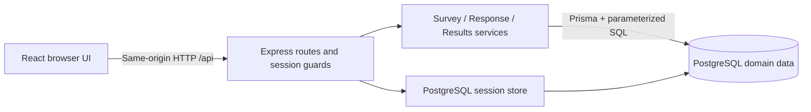

# LECTRA — System-Level Software Design Specification

Version: 0.1 (2026-11-06). Status: planning draft, not implemented or teammate-approved.
Related issue: [#3](https://github.com/Maibokdaimhai/LECTRA/issues/3).
Baseline: [SRS](srs.md), [decisions](decisions.md), [features](features.md).

## 1. Stack and components

| Layer | Selected tools | Responsibility |
| --- | --- | --- |
| Browser | React, Vite, TypeScript; ordinary CSS | Role-specific screens, accessible inputs, client feedback and API calls. No authoritative permission decisions. |
| API/application | Node.js, Express, TypeScript, Zod | Session-derived identity, validation, authorization, survey transitions, response transactions and results. |
| Authentication | express-session, connect-pg-simple, Argon2id | Opaque cookie session with PostgreSQL storage; password hashing and revocable logout. |
| Domain persistence | PostgreSQL, Prisma ORM | Domain queries, migrations, constraints and atomic transactions. Reviewed parameterized SQL is allowed for row locks/constraints where needed. |
| Tests | Vitest, Supertest, Playwright | Unit logic, HTTP API with real PostgreSQL integration, selected browser journeys. |
| Delivery plan | Docker, GitHub Actions, GCP Cloud Run and Cloud SQL for PostgreSQL | Proposed Lab 5 packaging, quality gates, application runtime and durable database. No infrastructure has been created. |

The frontend/test/database choices come from the project owner. The API/session/hash/validation/API-test additions fill missing responsibilities under explicit permission to choose additions. Compatible versions and type definitions must be pinned during authorized setup, before API-specific implementation contracts are finalized. No package is installed by this document.

The monolith has three logical layers, not three mandatory servers. In development, Vite proxies `/api` to Express. In release, Express serves the built frontend and `/api` on one origin. PostgreSQL is external to the application process/container. Business rules reside in application services plus database constraints, never only in React.

Proposed repository layout after setup: `apps/web`, `apps/api`, `prisma`, `tests/e2e`, and `docs`. This is a plan; those application directories do not exist yet. Use npm workspaces and one lockfile unless a recorded compatibility issue requires a different package-manager decision.

## 2. Major data model

| Entity | Important fields | Relationships / constraints |
| --- | --- | --- |
| User | id, email, passwordHash, role, displayName | Unique normalized email; role OWNER or RESPONDENT. |
| Classroom | id, courseCode, title, term, ownerId | Required instructor owner; only that owner manages its surveys. |
| Membership | classroomId, studentId | Unique pair; student role validated on seed/use. |
| Lecture | id, classroomId, title, lectureDate | Belongs to one classroom; date denotes classroom local calendar date. |
| Survey | id, lectureId, ownerId, title, status, mode, publishedAt, closedAt | Unique lectureId; owner must match classroom owner; transitions governed by service transaction. |
| Question | id, surveyId, position, prompt, type, required | Unique survey/position; type RATING/TEXT in S1, SINGLE_CHOICE in S2. |
| ChoiceOption (S2) | id, questionId, position, label | Unique question/position; selected answer must belong to its question. |
| SurveyEligibility | surveyId, studentId | Unique pair; publication snapshot, immutable after publish. |
| Participation | surveyId, studentId | Unique pair and FK to eligibility. The participation row is the submission-status source and carries no anonymous answer ID or per-submission timestamp. |
| ResponseBundle | id, surveyId, identifiedStudentId nullable | S1 identifiedStudentId is required by mode-aware service validation and references eligibility. In anonymous mode it must be null. No precise per-bundle submission timestamp. |
| Answer | bundleId, surveyId, questionId, ratingValue/textValue/optionId | Unique bundle/question; composite foreign keys keep bundle and question in the same survey; one type-specific value only; rating range CHECK 1–5. |
| Session store | sid, session payload, expiry | Managed by connect-pg-simple in a separately named table, schema created with versioned SQL migration rather than implicit production auto-create. |

Database CHECKs/foreign keys/unique constraints cover what can be expressed locally. Cross-table rules (e.g. owner/classroom consistency, answer type, response mode, required-question completeness) are checked by the authoritative service inside the transaction. Composite keys and relevant FK targets are specified fully in feature contracts and migrations before implementation. A unique index on `(surveyId, identifiedStudentId)` is additional protection for identified bundles; anonymous duplicate prevention uses Participation uniqueness.

Published questions/eligibility are immutable and cannot be removed through application routes. Draft deletion cascades Draft questions only after owner/state checks. Published records have no hard-delete application operation. Schema migration and deletion behavior must preserve submitted associations.

## 3. Transactions and concurrency

1. Publish locks the owned Survey row, checks Draft state, validates questions/lecture and candidate membership, creates the eligibility snapshot, then commits Published state atomically.
2. Submit locks the Survey row before reading its authoritative state, verifies the session student is eligible, checks typed answers, inserts unique Participation, bundle and all answers, and commits together.
3. Close takes the same row lock and changes Published to Closed. The lock/commit order defines BR-11, not arrival order at the browser or a client timestamp.
4. Concurrent duplicates are rejected by the database unique constraint even if both requests passed an earlier check. Map the constraint to a safe domain error; no partial answers remain.

Serialize per-survey submissions initially to keep correctness simple for a small classroom. Keep lock duration short; do not hash passwords, call external services or render results while holding it. Retry recognized deadlock/serialization failures only with a bounded policy defined in the contract. A lost confirmation never permits a second write; the student checks their persisted submission status.

Prisma transaction APIs depend on the pinned ORM version. This SDS specifies behavior and locking without assuming a particular version's client syntax.

## 4. Authentication and session lifecycle

- Login accepts email/password, compares an Argon2id password hash, returns a generic invalid-credentials message and never logs credentials. Seeded accounts are sufficient; no signup/recovery endpoints.
- Regenerate the session ID after successful authentication. Store only the minimum server-side identity data; re-resolve user role/permissions from trusted storage on protected requests.
- Use PostgreSQL session storage, not process-local MemoryStore. Set `resave: false` and `saveUninitialized: false`; pin and verify compatible middleware/store versions.
- Cookie: `HttpOnly`, `SameSite=Lax`, `Path=/`, fixed eight-hour expiry without rolling renewal; `Secure` in HTTPS deployment. Local HTTP development may disable Secure explicitly.
- `GET /api/auth/me` returns the current safe user identity or 401. Expired or missing sessions cannot access protected routes.
- `POST /api/auth/logout` destroys the server session and clears the cookie; subsequent replay of that cookie is unauthorized. Logout is idempotent.
- State-changing browser requests require a synchronizer CSRF token in `X-CSRF-Token`, including login/logout, plus Origin checking against the configured application origin. A session endpoint bootstraps the token. Do not treat SameSite alone as the complete CSRF control.
- Configure trusted proxy handling for the actual Cloud Run path; do not trust arbitrary forwarded headers. Add bounded login throttling before public deployment, with limits and tests specified in the authentication contract.

## 5. Role and record access matrix

All entries are backend rules. Inaccessible record identifiers return 404 to avoid confirming existence; an authenticated wrong role for a role-only operation returns 403; unauthenticated access returns 401. No private data accompanies rejection.

| Operation | Respondent | Owner |
| --- | --- | --- |
| Login/logout/me | Own session | Own session |
| List contexts | Eligible Published/Closed surveys only | Owned classrooms/lectures/surveys only |
| Read Draft / create/edit/delete Draft | Denied | Own only |
| Publish/close | Denied | Own only |
| Read survey for answering | Eligible Published/Closed; submitting requires Published | Own preview; cannot submit as student |
| Submit response | Eligible, Published, not already submitted | Denied |
| Read submission status | Own only | No per-student participation endpoint |
| Read identified answers | Own only | No respondent-linked answer endpoint |
| Read anonymous answers by identity | No such operation | No such operation |
| Read results/text | Denied | Own; count while Published, results after Closed under threshold policy |
| Export aggregates (S2) | Denied | Same constraints as results |

## 6. UI and API conventions

Main screens: login; student eligible-survey list, answering form and confirmation/own-status view; instructor survey list, Draft editor, survey detail/publication/closing controls, and results. Later additions: mode selection, single-choice/subset controls, CSV action, history filters/trends.

Every screen defines loading, empty, validation, unauthorized/expired-session and safe unexpected-error states. Disable repeated UI submission for feedback, but rely on backend/DB protection. Clear private cached UI state on logout. Result views never receive hidden identity fields. Do not display blank required text as valid or a null mean as zero.

API prefix `/api`; JSON bodies; server-generated IDs; session cookie rather than client-selected actor. Successful reads return `{ "data": ... }`; validation failures use `{ "error": { "code": "...", "message": "...", "fields": ... } }`. Never return stacks, SQL or credential/session values. Use 201 for creation/submission, 200 for reads/transitions, 204 for successful deletion/logout, 400 for malformed input, 401/403/404 for access, 409 for duplicate/state conflict and 422 for well-formed domain validation failure.

Candidate endpoint families, to be finalized with payloads in Issue #5:

| Family | Planned paths |
| --- | --- |
| Session | `GET /api/auth/session`, `POST /api/auth/login`, `GET /api/auth/me`, `POST /api/auth/logout` |
| Context/discovery | `GET /api/classrooms`, `GET /api/classrooms/:id/lectures`, `GET /api/surveys` |
| Survey | `POST /api/surveys`, `GET/PATCH/DELETE /api/surveys/:id`, `POST /api/surveys/:id/publish`, `POST /api/surveys/:id/close` |
| Response | `POST /api/surveys/:id/responses`, `GET /api/surveys/:id/my-submission` |
| Results | `GET /api/surveys/:id/results`, later `GET /api/surveys/:id/export.csv` |

List endpoints use bounded pagination; the default/maximum and filtering schemas must be specified in feature contracts. JSON request bodies are bounded at 64 KiB initially. Zod validates payload shape; the application validates database-backed eligibility/state/ownership in the same transaction that writes. Do not accept supplied `ownerId`, `role` or `studentId` as actor identity.

## 7. Anonymous-mode design boundary and gate

Identified mode intentionally stores a student-to-bundle link. Anonymous mode does not. Participation records enforce eligibility/one submission and expose own status; answer bundles contain no identity or participation reference. Anonymous students cannot reopen their answers through a user-linked endpoint.

Separating tables does not by itself establish anonymity. Row order, generated IDs, request timing, logs, database audit records and backups can correlate identity and answers. For F-06, its contract must define unguessable independent answer IDs, collection/order handling, absence of per-answer timing metadata, logging redaction/retention, result-release controls and adversarial tests. No identity-bearing response payloads or correlation IDs may enter answer records or exports.

The threat boundary covers owners/ordinary application users; it explicitly does not claim unlinkability against privileged transaction/network observation. Owners cannot see per-student participation. Anonymous results/text/exports appear only after closure and five submissions. Free text can self-identify; warn students not to include identifying details. A threshold reduces small-group exposure but is not proof of anonymity.

F-06 is blocked until OPEN-04 is resolved in a reviewed contract. Do not enable an anonymous checkbox before the actual privacy behavior and tests exist.

## 8. Database setup, configuration and delivery

Version domain schema and custom session/constraint SQL together through Prisma migrations. A documented seed produces at least two owners in distinct classrooms, multiple students including one ineligible/cross-class student, memberships and lectures. Tests use a dedicated PostgreSQL test database; never reset the development or deployed database during tests. Seeds are repeatable against a disposable demo database, hash local demo passwords and avoid real student records.

Configuration plan: `DATABASE_URL`, dedicated `TEST_DATABASE_URL`, `SESSION_SECRET`, `APP_ORIGIN`, `PORT`, `NODE_ENV`, and local-only demo seed credentials. Commit variable names/examples only. Obtain demo passwords via local seed/private course handoff, not real secrets in Git/PDF. Reject missing required production configuration.

Lab 5 proposal: Docker multi-stage build serving frontend/API in Cloud Run, Cloud SQL PostgreSQL for durable domain/session data, Artifact Registry for images, Secret Manager for runtime secrets, and least-privilege deployment identity. Database persistence never depends on the container filesystem. Confirm components/access under Lab 5 guidance before provisioning.

GitHub Actions will run build/unit/integration/selected E2E checks on relevant PRs with PostgreSQL test service, protect the normal release path against failed required checks, and deploy accepted `main` releases through a repeatable pipeline. A manual approval within that pipeline is acceptable. Serialize migration/deployment steps and record release SHA; never run destructive seed on production. A separate cloud staging environment is not required.

## 9. Verification and current limitations

Vitest covers validation/summary/state logic; Supertest drives Express with real PostgreSQL for permissions/transactions/retrieval; Playwright covers owner publish → student submit → owner closed-results and selected rejection journeys. Preserve meaningful TDD failures before corrections. Mock-only persistence is insufficient.

Current state: documentation only; no application, installed dependencies, migrations, tests, runtime commands or measured results. OPEN-01/02/04/05 remain review/setup gates. Feature-level contracts must finalize request/response shapes, schema details and test cases before each implementation.

## Technical references

- [Express session middleware](https://expressjs.com/en/resources/middleware/session/): server-side session model and store/cookie options.
- [connect-pg-simple](https://github.com/voxpelli/node-connect-pg-simple): PostgreSQL session-store setup and schema.
- [Prisma transactions](https://www.prisma.io/docs/orm/fundamentals/transactions): transaction semantics; use the documentation matching the pinned version during setup.
